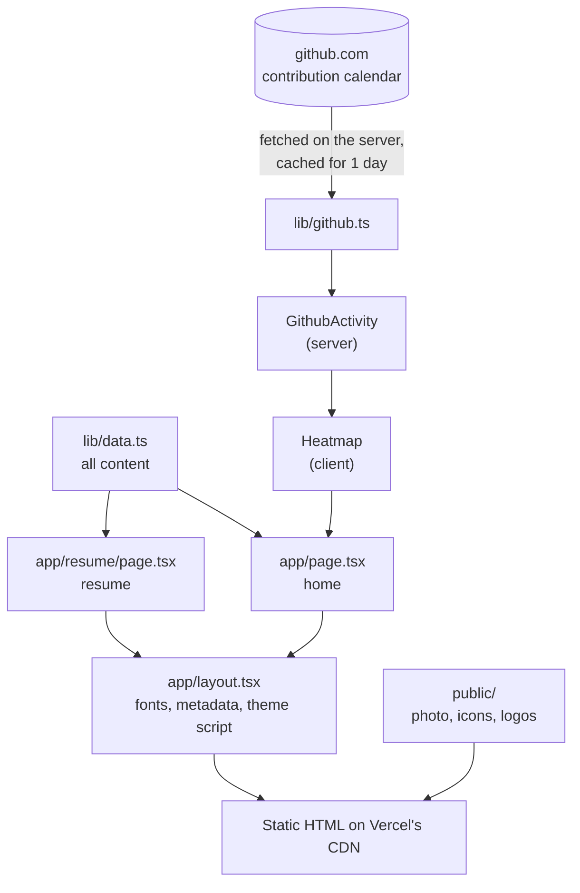

# Priyadarsni JK — Portfolio

Personal portfolio and resume site for **Priyadarsni JK**, an AI and Data Science engineer from Chennai, India.

It is a single quiet page (bio, GitHub activity, projects, stack, experience, education, certificates) plus a printable resume page. Built with Next.js and deployed on Vercel.

- GitHub: [priyadjk](https://github.com/priyadjk)
- LinkedIn: [priyadarsni-jk](https://www.linkedin.com/in/priyadarsni-jk-745a0025b/)

## Features

- **One file of content.** Everything the site says lives in [`lib/data.ts`](lib/data.ts). Components only render it.
- **Live GitHub heatmap.** The contribution calendar is fetched on the server, cached for a day, and can be filtered to 7 days, 30 days, 90 days or a year.
- **Project carousel and grid.** Eleven projects with drawn covers, switchable between a swipeable row and a grid.
- **Stack with real brand icons.** Hovering (or tapping) a tool lists the projects that use it.
- **Resume page.** `/resume` is the resume as a web page, with a "save PDF" button and a print stylesheet.
- **Light, dark and system themes**, with no flash on load.
- **Responsive** from 320px phones to wide desktops, and respects reduced-motion settings.
- **SEO basics**: metadata, Open Graph, JSON-LD profile, sitemap and robots.

## Tech stack

| Layer     | Choice                                              |
| --------- | --------------------------------------------------- |
| Framework | Next.js 16 (App Router, Cache Components, Turbopack) |
| UI        | React 19, TypeScript                                |
| Styling   | Plain CSS with design tokens (`app/globals.css`)    |
| Fonts     | Inter and Caveat through `next/font`                |
| Hosting   | Vercel                                              |

There is no database, no CMS and no client-side data fetching.

## Getting started

Requires Node.js 20.9 or newer.

```bash
npm install
npm run dev
```

Open <http://localhost:3000>.

| Script          | What it does                         |
| --------------- | ------------------------------------ |
| `npm run dev`   | Start the development server         |
| `npm run build` | Create the production build          |
| `npm run start` | Serve the production build           |
| `npm run lint`  | Run ESLint                           |

## Architecture

### How a page is built



Both pages are prerendered as static HTML at build time. The only outside data is the GitHub contribution calendar, which `lib/github.ts` reads inside a `"use cache"` function with a one-day lifetime. Vercel regenerates the home page in the background when that cache expires, so the heatmap stays fresh without a redeploy. If GitHub cannot be reached, the heatmap is simply left out.

### Server and client components

Most of the site is server components and ships no JavaScript. Only four pieces are interactive:

| Client component              | Why it needs the browser                   |
| ----------------------------- | ------------------------------------------ |
| `components/heatmap.tsx`      | Range switch and hover tooltip             |
| `components/work.tsx`         | Carousel / grid toggle                     |
| `components/footer.tsx`       | Live clock and theme switch                |
| `components/print-button.tsx` | Opens the print dialog on the resume page  |

### Theming

Colours are CSS custom properties on `:root`. A small inline script in `app/layout.tsx` runs before first paint, reads the saved choice from `localStorage` (or the system setting) and sets `data-theme` on `<html>`, so the page never flashes the wrong theme. The switch in the footer updates the same attribute. Print always uses the light palette.

### Project structure

```text
.
├── app/
│   ├── layout.tsx          Root layout: fonts, metadata, theme script
│   ├── page.tsx            Home page, composed from the sections below
│   ├── resume/page.tsx     Resume page (printable)
│   ├── not-found.tsx       404 page
│   ├── globals.css         Design tokens and every style
│   ├── sitemap.ts          /sitemap.xml
│   ├── robots.ts           /robots.txt
│   └── icon.png            Favicon (also apple-icon.png)
├── components/
│   ├── header.tsx          Avatar, name and the page actions pill
│   ├── bio.tsx             Opening paragraphs with inline logos
│   ├── github-activity.tsx Loads contributions on the server
│   ├── heatmap.tsx         Contribution calendar with range switch
│   ├── work.tsx            Project carousel / grid and grouped index
│   ├── cover.tsx           Drawn SVG cover for each project
│   ├── stack.tsx           Tools grouped by kind, with "used in" popovers
│   ├── timeline.tsx        Experience, education and certificates
│   ├── footer.tsx          Local time and theme switch
│   ├── section.tsx         Section heading, margin notes, logo stacks
│   ├── icon.tsx            Tech icons, organisation marks, UI glyphs
│   └── print-button.tsx    "save PDF" button
├── lib/
│   ├── data.ts             All content: profile, projects, stack, roles
│   ├── github.ts           Fetches and parses the contribution calendar
│   └── site-url.ts         Resolves the public site URL
└── public/
    ├── profile.jpg         Avatar
    ├── priyadarsni.webp    Full photo (social preview)
    ├── icons/              Technology logos
    └── logos/              College, company and issuer logos
```

## Editing content

Open [`lib/data.ts`](lib/data.ts). It is the only file you need for routine updates.

| To change                         | Edit                                              |
| --------------------------------- | ------------------------------------------------- |
| Name, email, links, summary       | `site`                                            |
| The "Updated ..." date            | `site.updated`                                    |
| A project                         | Add or edit an entry in `projects`                |
| A tool in the stack               | Add it to `tech`, then to a row in `stack`        |
| An internship                     | `experience`                                      |
| Degree or CGPA                    | `education`                                       |
| A certificate                     | `certifications`                                  |

Notes:

- A new tool needs an icon file in `public/icons/`. Set `mono: true` for single-colour black artwork so it inverts in dark mode.
- A new project picks one of the existing cover drawings through `cover`, and a colour through `accent`.
- The intro paragraphs are written by hand in [`components/bio.tsx`](components/bio.tsx).
- To replace the photo, overwrite `public/profile.jpg` (square, face centred), `public/priyadarsni.webp` and `app/icon.png`.

## Deploying to Vercel

1. Push this repository to GitHub.
2. In Vercel, choose **Add New → Project** and import the repository.
3. Keep the detected settings (framework: Next.js, build command: `next build`).
4. Deploy.

No environment variables are required. One is optional:

| Variable               | Purpose                                                                                   |
| ---------------------- | ----------------------------------------------------------------------------------------- |
| `NEXT_PUBLIC_SITE_URL` | Your custom domain, for example `https://example.com`. Used for canonical links, Open Graph and the sitemap. Without it, the Vercel production URL is used. |

## Credits

Technology and company logos belong to their respective owners and are used only to identify those tools and organisations. Technology icons come from [Devicon](https://devicon.dev), [Simple Icons](https://simpleicons.org) and [SVGL](https://svgl.app).
